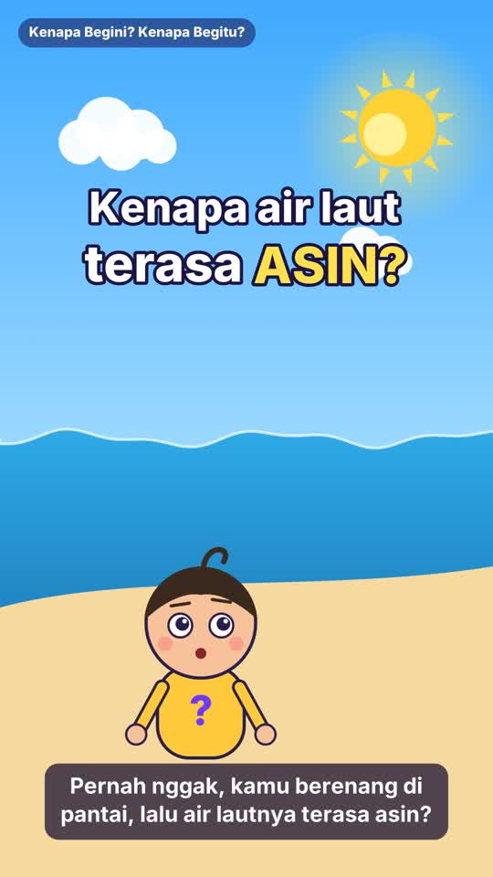

# Kenapa Begini? Kenapa Begitu? — Eps. 2: Kenapa Air Laut Asin?

Video pendek vertikal (1080×1920, 30 fps, ±97 detik) untuk Shorts / Reels / TikTok.



- **Video:** [`ep02-kenapa-laut-asin.mp4`](ep02-kenapa-laut-asin.mp4)
- **Topik sains:** pelapukan batuan, siklus air, dan kenapa garam menumpuk di laut

## Naskah

| # | Adegan | Narasi |
|---|--------|--------|
| 1 | Pembuka | Halo, teman-teman! Kembali lagi di Kenapa Begini, Kenapa Begitu! Kali ini kita akan menyelam ke laut! |
| 2 | Pantai — Tanya kaget "Asin!" | Pernah nggak, kamu berenang di pantai, lalu air lautnya terasa asin? Padahal air hujan dan air sungai tidak asin. Kok bisa? |
| 3 | Hujan mengikis gunung batu | Ceritanya dimulai dari hujan. Air hujan sedikit bersifat asam, jadi pelan-pelan mengikis batuan di daratan. Dari batuan itu, lepaslah mineral dan garam yang sangat kecil. |
| 4 | Sungai membawa garam + gunung api bawah laut | Garam-garam ini terbawa aliran sungai, terus menuju ke laut. Ada juga garam yang keluar dari gunung berapi di dasar laut. |
| 5 | Penguapan — garam tertinggal | Di laut, matahari memanaskan air sehingga menguap ke udara. Tapi garamnya tidak ikut menguap. Garamnya tertinggal di laut! Uap air jadi awan, lalu turun lagi sebagai hujan yang tawar. |
| 6 | Jutaan tahun — garam menumpuk, 1 L ≈ 35 g | Proses ini terjadi terus-menerus, selama jutaan tahun. Garam pun makin menumpuk, sampai air laut jadi asin seperti sekarang. Dalam satu liter air laut, ada sekitar 35 gram garam. Kira-kira dua sendok makan! |
| 7 | Rangkuman, fakta seru (lapisan garam > 150 m vs Monas 132 m), penutup | Jadi, laut asin karena garam dari daratan terbawa ke laut, dan tertinggal saat airnya menguap. Fakta seru: kalau semua garam laut disebar di daratan, tebalnya lebih dari 150 meter. Lebih tinggi dari Monas! Punya pertanyaan lain? Tulis di kolom komentar ya. Sampai jumpa! |

## Teks unggahan

**Judul YouTube:** Kenapa Air Laut Asin, Padahal Hujan Tawar? 🌊 | Kenapa Begini? Kenapa Begitu? Eps. 2

**Deskripsi:**
```
Pernah nggak kamu berenang di pantai, lalu air lautnya terasa asin? Padahal air hujan dan air sungai tawar. Kok bisa? 🤔

Di episode 2 Kenapa Begini? Kenapa Begitu?, Tanya ngajak kamu cari tahu!

🌧️ Hujan pelan-pelan mengikis batuan dan melepaskan garam
🏞️ Sungai membawa garam itu ke laut
☀️ Air laut menguap, tapi garamnya tertinggal
🧂 1 liter air laut ≈ 35 gram garam (sekitar 2 sendok makan!)

Fakta seru: kalau semua garam laut disebar di daratan, tebalnya lebih dari 150 meter. Lebih tinggi dari Monas!

Punya pertanyaan "kenapa" lainnya? Tulis di kolom komentar! 👇

#KenapaBeginiKenapaBegitu #SainsAnak #Shorts #LautAsin #FaktaUnik #BelajarSains #EdukasiAnak
```

**Tags YouTube:**
```
kenapa begini kenapa begitu, kenapa air laut asin, air laut asin, kenapa laut asin, garam laut, siklus air, penguapan, pelapukan batuan, sains anak, sains untuk anak, belajar sains, edukasi anak, video edukasi, fakta unik, fakta sains, ipa sd, pengetahuan umum, monas, shorts edukasi, animasi edukasi, why is the ocean salty
```

**Caption TikTok:**
```
Kenapa air laut asin, padahal air hujan tawar? 🌊🧂 Jawabannya ternyata dimulai dari batu di gunung! Tonton sampai akhir, ada fakta seru soal Monas 😲

Mau tahu "kenapa" apa lagi? Tulis di komentar! 👇

#KenapaBeginiKenapaBegitu #kenapalautasin #sainsanak #belajarditiktok #edukasi #faktaunik #sains #fyp #fypシ #pengetahuanumum #edukasianak #samasamabelajar
```

## Membuat ulang video

```bash
python3 make_video.py            # -> ep02-kenapa-laut-asin.mp4
python3 make_video.py --stills   # satu PNG per adegan untuk dicek
```
Kebutuhan sistem sama dengan Eps. 1 (lihat `../README.md`).
