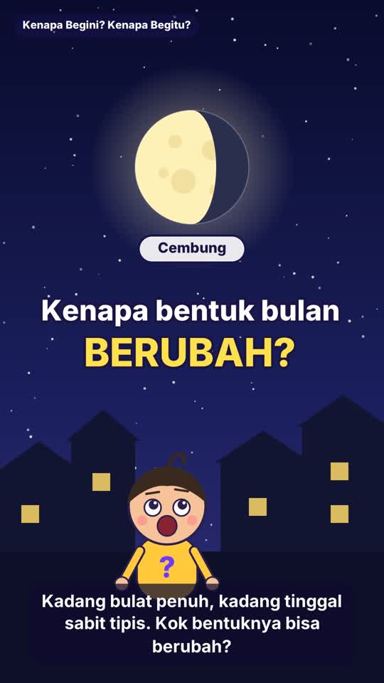

# Kenapa Begini? Kenapa Begitu? — Eps. 3: Kenapa Bentuk Bulan Berubah-ubah?

Video pendek vertikal (1080×1920, 30 fps, ±93 detik) untuk Shorts / Reels / TikTok.



- **Video:** [`ep03-kenapa-bentuk-bulan.mp4`](ep03-kenapa-bentuk-bulan.mp4)
- **Topik sains:** fase bulan, pantulan cahaya, orbit bulan, dan beda fase bulan dengan gerhana

## Naskah

| # | Adegan | Narasi |
|---|--------|--------|
| 1 | Pembuka | Halo, teman-teman! Kembali lagi di Kenapa Begini, Kenapa Begitu! Kali ini kita lihat langit malam, yuk! |
| 2 | Malam — bulan berganti-ganti bentuk di atas atap rumah | Pernah nggak, kamu perhatikan bulan? Kadang bulat penuh, kadang tinggal sabit tipis. Kok bentuknya bisa berubah? |
| 3 | Bulan memantulkan cahaya matahari | Bulan sebenarnya tidak bisa bersinar sendiri. Cahayanya berasal dari matahari, yang memantul di permukaan bulan. Jadi, separuh bulan yang menghadap matahari selalu terang, separuhnya lagi gelap. |
| 4 | Orbit — bulan mengelilingi bumi + "Dari bumi terlihat" | Bulan bergerak mengelilingi bumi, kira-kira sebulan sekali. Saat bulan berpindah tempat, bagian terang yang bisa kita lihat dari bumi ikut berubah. |
| 5 | Urutan fase | Mulai dari bulan baru, lalu sabit, separuh, cembung, sampai purnama! Setelah purnama, bentuknya mengecil lagi, sampai kembali jadi bulan baru. |
| 6 | Mitos bayangan bumi → gerhana bulan | Banyak yang mengira bentuk bulan berubah karena tertutup bayangan bumi. Itu salah! Bayangan bumi hanya menutupi bulan saat terjadi gerhana bulan. Dan gerhana bulan itu jarang, tidak terjadi setiap malam. |
| 7 | Rangkuman, fakta seru (29,5 hari = 1 bulan), penutup | Jadi, bentuk bulan berubah karena kita melihat bagian terangnya dari sudut yang berbeda-beda. Fakta seru: dari bulan baru ke bulan baru lagi butuh sekitar 29,5 hari. Makanya disebut satu bulan! Punya pertanyaan lain? Tulis di kolom komentar ya. Sampai jumpa! |

## Teks unggahan

**Judul YouTube** (pilih satu):
- Kenapa Bentuk Bulan Berubah-ubah? 🌙 | Kenapa Begini? Kenapa Begitu? Eps. 3
- Bulan Nggak Pernah Berubah Bentuk, Ini Rahasianya! 🌓 #Shorts
- Sabit, Separuh, Purnama, Kok Bisa? 🤔 | Sains Seru untuk Anak

**Deskripsi:**
```
Pernah nggak kamu perhatikan bulan? Kadang bulat penuh, kadang tinggal sabit tipis. Kok bentuknya bisa berubah? 🤔🌙

Di episode 3 Kenapa Begini? Kenapa Begitu?, Tanya ngajak kamu cari tahu!

☀️ Bulan tidak bersinar sendiri, ia memantulkan cahaya matahari
🌗 Separuh bulan selalu terang, separuhnya lagi gelap
🌍 Bulan mengelilingi bumi, jadi bagian terang yang kita lihat berubah-ubah
🌑🌒🌓🌔🌕 Bulan baru → sabit → separuh → cembung → purnama, lalu mengecil lagi
❌ Bukan karena bayangan bumi! Itu cuma terjadi saat gerhana bulan

Fakta seru: dari bulan baru ke bulan baru lagi butuh sekitar 29,5 hari. Makanya disebut satu "bulan"! 📅

Punya pertanyaan "kenapa" lainnya? Tulis di kolom komentar, siapa tahu jadi episode berikutnya! 👇

Jangan lupa like, subscribe, dan nyalakan lonceng 🔔 biar nggak ketinggalan episode baru.

Episode sebelumnya: Kenapa Air Laut Asin? 🌊

#KenapaBeginiKenapaBegitu #SainsAnak #Shorts #FaseBulan #FaktaUnik #BelajarSains #EdukasiAnak
```

**Tags YouTube:**
```
kenapa begini kenapa begitu, kenapa bentuk bulan berubah, fase bulan, fase-fase bulan, bulan sabit, bulan purnama, bulan separuh, bulan cembung, bulan baru, gerhana bulan, orbit bulan, astronomi anak, sains anak, sains untuk anak, belajar sains, edukasi anak, video edukasi, fakta unik, fakta sains, ipa sd, pengetahuan umum, shorts edukasi, animasi edukasi, moon phases explained
```

**Caption TikTok:**
```
Kenapa bentuk bulan berubah-ubah? 🌙 Ternyata bulannya nggak berubah, yang berubah itu cara kita melihatnya! Tonton sampai akhir, ada fakta seru kenapa disebut "bulan" 📅

Mau tahu "kenapa" apa lagi? Tulis di komentar! 👇
```

**Hashtag TikTok:**
```
#KenapaBeginiKenapaBegitu #fasebulan #bulanpurnama #sainsanak #belajarditiktok #edukasi #faktaunik #sains #astronomi #fyp #fypシ #pengetahuanumum #edukasianak #samasamabelajar
```

## Membuat ulang video

```bash
python3 make_video.py            # -> ep03-kenapa-bentuk-bulan.mp4
python3 make_video.py --stills   # satu PNG per adegan untuk dicek
```
Kebutuhan sistem sama dengan episode lain (lihat `../README.md`).
